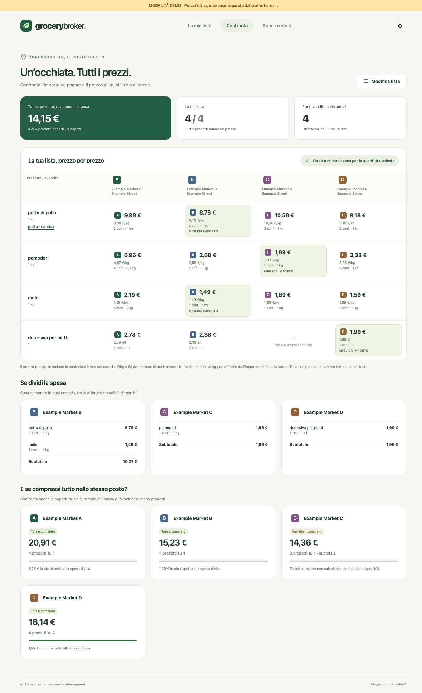

# Grocery Broker

A PHP and SQLite project for comparing local grocery offers and planning where to buy each item on a shopping list.

## Project status

**Runnable local prototype. Live data integration is paused; forks are welcome.**

Built with PHP, SQLite, HTML, CSS and vanilla JavaScript, without Composer, npm or a frontend build. The repository includes the application, a synthetic demo, assisted imports and tests. The interface, product dictionary and most validation messages currently remain in Italian; documentation is in English. Currency is EUR, the timezone is Europe/Rome and postal codes use five digits. Internationalization is future work.

The main obstacle is reliable offer data: there is no verified, free, documented API covering the retailers needed for the original pilot. Public pages and promotional leaflets can provide partial information, but collection requires ongoing maintenance and validation. This project does not promise comprehensive coverage or a production-ready data service.

## Quick start

Use a currently supported PHP release (syntax minimum: PHP 8.0) with `pdo_sqlite` and `mbstring`. Python 3 is only needed for HTTP tests. Poppler's `pdftotext` is optional for the app and required for PDF tests. No external requests are made on startup or comparison.

From the repository root:

```sh
php bin/demo.php
GROCERY_DB="$PWD/var/demo.sqlite" php -S 127.0.0.1:8788 -t public public/router.php
```

Open <http://127.0.0.1:8788>. Stop the server with Ctrl+C. Demo prices and stores are fictional. Its offers are generated for the current week; to reset the demo, stop its server, move `var/demo.sqlite` and any matching `-wal`/`-shm` files out of the way, then run the commands again. Do not reset a database containing work you want to keep.

For an empty offers database with the fictional store catalogue:

```sh
php -S 127.0.0.1:8787 -t public public/router.php
```

This uses `var/grocery-broker.sqlite`. Select stores in **Supermercati**, enter a list in **La mia lista**, then choose **Confronta**. Settings (the gear button) provide CSV, textual PDF and manual imports. `pollo`, `pomodori`, `mele` and `detersivo per piatti` are example dictionary entries; generic chicken requires choosing a cut before it contributes to totals.

The built-in server is for trusted local use only. Keep it bound to `127.0.0.1`; this prototype is not hardened for public hosting. Database files live outside `public/` and are ignored by Git.



## Development

```sh
php tests/run.php
# With the demo server above running, and its initial list unchanged:
python3 tests/http_checks.py
```

See [architecture](docs/ARCHITECTURE.md), [connector and import guide](docs/DATA_SOURCES.md), [contributing](CONTRIBUTING.md) and [verification](docs/VERIFICATION.md).

## What the prototype explores

- Shopping lists with explicit quantities and preferred stores.
- Comparable unit prices, such as price per kilogram, litre or item.
- Checkout estimates that account for whole packages and required quantities.
- Splitting a shopping list between stores or comparing a basket at one store.
- Coverage indicators: missing prices remain unknown, never zero.
- Offer validity, loyalty conditions, source references and assisted imports.

For example, a 300 g package priced at 1.50 costs 5.00 per kilogram. Buying at least 1 kg requires four packages: 6.00 for 1.2 kg. The lowest unit price and the lowest checkout cost are not always the same.

## Direction for future development

Separate the comparison engine from retailer-specific data sources. The included synthetic demo, connector interface and import examples let developers adapt the project to their own region without depending on one live source.

This repository does not provide live offers, a public offers API, retailer credentials, third-party datasets or an automated leaflet-reading service. No retailer affiliation or endorsement is implied.

## Data collection and responsible use

Software availability does not grant permission to access, extract, retain or redistribute someone else's data. Anyone operating a collector must establish that their access and intended use are permitted, respect applicable terms and technical restrictions, and obtain any necessary authorizations.

Do not bypass authentication, CAPTCHAs, access controls or explicit blocks. Minimize requests and data retention, avoid collecting personal information, and stop collection when permission or source validity is uncertain. A publicly accessible page is not evidence of a reusable data licence.

Offer prices, dates, package sizes and store applicability must be verified before use. Estimates do not guarantee shelf availability, checkout prices or savings. Historical receipts must not be presented as current offers.

See [DISCLAIMER.md](DISCLAIMER.md) for the scope of the project and limitations of responsibility.

## Licence and attribution

Original project materials are provided under the [MIT License](LICENSE). Commercial use, modification and redistribution are permitted. You must retain the copyright notice and the MIT permission notice in all copies or substantial portions of the materials.

Please also credit "Grocery Broker by MarcoRuffati" and link to the original repository in your documentation or credits. This additional acknowledgement is appreciated, but is not an extra licence condition. MIT does not require an on-screen credit or the publication of modifications.

The licence covers original project materials, not third-party data, images, trademarks or access to external services. [DISCLAIMER.md](DISCLAIMER.md) explains operational responsibilities and limitations; it does not add restrictions to the MIT licence or remove rights granted by it.

## Authorship and contact

Created by [MarcoRuffati](https://github.com/MarcoRuffati).

Original project: <https://github.com/MarcoRuffati/grocery-broker>.

For questions about the project or permission requests, open a repository issue without including credentials, personal information or confidential material.
